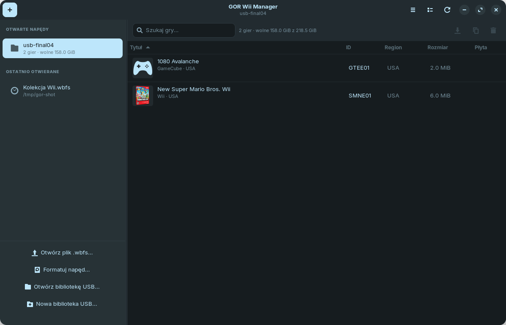

# GOR Wii Manager dla Linuksa

Natywna aplikacja GTK4/Libadwaita do zarządzania kopiami gier **Wii** i
**GameCube** zapisanymi w partycjach i plikach **WBFS**. To linuxowy
odpowiednik *Wii Backup Manager* (Windows) — bez Wine, bez zewnętrznych
binarek i bez uruchamiania całego programu jako root.



> **Język interfejsu:** domyślnie angielski; polski wybierzesz w
> **Ustawienia → Język interfejsu**. Zmiana działa od razu, bez restartu.
>
> Strona projektu: <https://multicolor-rgb.github.io/GOR_WII_Manager/>

## Funkcje

- **Napędy WBFS** — otwieranie plików `.wbfs`, partycji WBFS oraz plików
  dzielonych `.wbfs` + `.wbf1…9`. Partycje WBFS są rozpoznawane przez
  dołączoną regułę udev (libblkid nie zna tego formatu), a dostęp do
  surowego urządzenia odbywa się przez UDisks2 z autoryzacją polkit.
- **Formatowanie** — tworzenie nowego pliku WBFS o wybranym rozmiarze lub
  formatowanie partycji USB (z autoryzacją polkit).
- **Import** — obrazy Wii/GameCube `.iso`, `.gcm`, skompresowane **`.rvz`**
  (Dolphin) oraz gry z innych napędów WBFS. Czyszczenie („scrub”) usuwa
  nieużywane sektory i domyślnie pomija partycję aktualizacji.
- **RVZ bez Dolphin** — natywny czytnik kontenera RVZ (Zstandard, LZMA,
  LZMA2, BZip2, NONE, padding RVZ). Import do WBFS, konwersja do ISO i do
  pojedynczego pliku `.wbfs` odbywa się bez programów zewnętrznych.
- **Biblioteka USB jako napęd** — folder na dysku FAT32/NTFS jest
  otwierany jak normalny napęd: lista gier (każda gra jako **osobny**
  `wbfs/<Tytuł> [<ID>]/<ID>.wbfs`), dodawanie ISO/GCM/RVZ, kopiowanie
  w obie strony, usuwanie i wypakowanie. GameCube trafia do Nintendont:
  `games/<Tytuł> [<ID>]/game.iso`. Automatyczne wykrywanie zamontowanych
  bibliotek USB.
- **Eksport** — wypakowanie do ISO (z zachowaniem oryginalnego rozmiaru
  jedno- lub dwuwarstwowego) albo do pojedynczego/dzielonego pliku WBFS.
- **Kopiowanie** — przenoszenie gier między otwartymi napędami bez tworzenia
  plików pośrednich.
- **Weryfikacja i naprawa** — odtworzenie tablicy wolnych bloków na podstawie
  wpisów gier, wykrywanie zdublowanych i nieprawidłowych bloków.
- **Tytuły i okładki** — baza WiiTDB/GameTDB z lokalnym cache, polskie tytuły
  gdy są dostępne, miniatury okładek w liście gier.
- **Kolejka zadań** — postęp, prędkość, ETA i anulowanie długich operacji.
- **Wygodny interfejs** — wyszukiwanie, sortowanie, wielokrotny wybór,
  właściwości gry z listą partycji, tryb tylko-do-odczytu.
- **Dwa języki** — angielski (domyślny) i polski do wyboru w ustawieniach;
  wybór obejmuje również język tytułów z bazy WiiTDB.
- **CLI** — te same operacje z terminala, przydatne w skryptach.

## Wymagania

- Linux z GTK 4 i libadwaita (np. Ubuntu 24.04+, Zorin OS 18, Fedora 40+)
- `python3` (3.10+), `python3-gi`, `gir1.2-gtk-4.0`, `gir1.2-adw-1`
- `python3-cryptography` (AES-128 do odtwarzania obrazu z RVZ)
- `libzstd1` (dekompresja RVZ; zwykle instalowany systemowo)
- `udisks2` (dostęp do surowych partycji WBFS)
- `pkexec` (formatowanie partycji)

Na Ubuntu/Zorinie:

```bash
sudo apt install python3-gi gir1.2-gtk-4.0 gir1.2-adw-1 \
    python3-cryptography libzstd1 udisks2 pkexec
```

## Instalacja z paczki .deb

```bash
make deb
sudo apt install ./dist/gor-wii-manager_0.6.0_all.deb
```

Aplikacja pojawi się w menu jako **GOR Wii Manager**, a w terminalu jako
`gor-wii-manager`. Pakiet instaluje też `gor-wii-manager-helper` (wywoływany
przez `pkexec`) oraz politykę polkit.

Przy pierwszym uruchomieniu ustawienia, baza tytułów i okładki są
automatycznie przenoszone z katalogów `wbfs-manager`. Przez jedną wersję
dostępny jest też przejściowy symlink polecenia `wbfs-manager`.

## Biblioteka USB jako napęd

1. **Menu → Biblioteka USB → Nowa biblioteka USB…** (tworzy `wbfs/` i
   `games/` na wybranym dysku) albo **Otwórz bibliotekę USB…**.
2. Biblioteka pojawi się w panelu po lewej jak napęd.
3. **+** dodaje ISO/GCM/RVZ — każda gra od razu jako osobny plik.
4. Zaznacz gry i używaj **Kopiuj / Usuń / Wypakuj** jak na napędzie WBFS.
5. Zamontowane dyski z istniejącym `wbfs/` lub `games/` są wykrywane
   automatycznie w sekcji **Biblioteki USB**.

Pliki, które trafią na dysk, są zgodne z USB Loader GX, WiiFlow i CFG
Loader (oraz Nintendont dla GameCube). Nadal można też używać klasycznego
napędu WBFS (jeden kontener z wieloma grami).

## Eksport do biblioteki USB

Menu **Biblioteka USB** (albo polecenie `export`) tworzy układ zgodny z
USB Loader GX, WiiFlow i CFG Loader:

```
USB/
├─ wbfs/
│  └─ New Super Mario Bros. Wii [SMNE01]/
│     ├─ SMNE01.wbfs
│     └─ SMNE01.wbf1        # tylko na FAT32, gdy gra > 4 GiB
└─ games/
   └─ 1080 Avalanche [GTEE01]/
      └─ game.iso            # Nintendont (GameCube)
```

- Domyślnie istniejące gry są **nadpisywane** (opcje „pomiń” i „pytaj” są
  dostępne w oknie eksportu i w CLI).
- Kopiowanie gry z WBFS zachowuje jej istniejące bloki: jeśli gra ma
  368 MB, na dysku docelowym również zajmie około 368 MB (bez rozdymania
  do pełnej partycji).
- Nazwa folderu jest dowolna dla loaderów; plik musi nazywać się `ID.wbfs`.
- Eksport jest atomowy: najpierw budowany jest komplet plików w katalogu
  tymczasowym, a dopiero potem zastępowane są stare.
- Pojedyncze pliki `.wbfs` otwiera się przez **Otwórz plik .wbfs**, a potem
  eksportuje zaznaczone gry. 
- Wykrywane są zamontowane dyski FAT32/NTFS/exFAT/ext4; dla GX zalecany
  jest FAT32/NTFS.

```bash
# zaznaczone gry z WBFS
gor-wii-manager export /media/usb gry.wbfs --ids SMNE01,RSPE01

# wszystkie gry z WBFS
gor-wii-manager export /media/usb gry.wbfs --all

# pliki ISO/GCM/RVZ
gor-wii-manager export /media/usb --file gra.rvz --file gra.iso

# podgląd planu bez zapisu
gor-wii-manager export /media/usb gry.wbfs --all --dry-run
```

## Uruchomienie ze źródeł

```bash
PYTHONPATH=src python3 -m gor_wii_manager
# lub z automatycznym otwarciem napędu:
PYTHONPATH=src python3 -m gor_wii_manager --open /media/dysk/gry.wbfs
```

## Obsługa

1. Podłącz dysk USB z partycją WBFS albo utwórz nowy plik: **Menu → Formatuj
   nowy napęd…**.
2. Wybierz napęd w panelu po lewej.
3. **+** (lub `Ctrl+N`) dodaje obrazy gier (także `.rvz`); menu zawiera też
   dodawanie całych folderów i konwersję RVZ/ISO do ISO lub `.wbfs`.
4. Zaznacz gry i użyj przycisków u góry: **Wypakuj**, **Kopiuj**, **Usuń**.
5. Dwuklik na grze otwiera właściwości (partycje, rozmiary, okładka, zmiana
   nazwy).

Skróty: `Ctrl+O` otwórz, `Ctrl+N` dodaj, `Ctrl+E` wypakuj, `Delete` usuń,
`Ctrl+A` zaznacz wszystko, `F5` odśwież, `Ctrl+,` ustawienia.

### Gdzie trzymane są dane

- konfiguracja: `~/.config/gor-wii-manager/settings.json`
- baza tytułów: `~/.local/share/gor-wii-manager/titles*.txt`
- okładki: `~/.cache/gor-wii-manager/covers/`

## CLI

```bash
# informacje o napędzie albo bibliotece folderowej
gor-wii-manager info /media/dysk/gry.wbfs
gor-wii-manager info /media/usb

# lista gier (z tytułami z WiiTDB)
gor-wii-manager list /media/dysk/gry.wbfs
gor-wii-manager list /media/usb

# nowy plik WBFS 64 GiB, blok 8 MiB
gor-wii-manager format gry.wbfs --size 64G --block-size 8388608

# import ISO lub RVZ (do WBFS albo bezpośrednio do biblioteki USB)
gor-wii-manager import gry.wbfs obraz.iso
gor-wii-manager import gry.wbfs gra.rvz
gor-wii-manager import /media/usb gra.rvz

# wypakowanie do ISO i do pojedynczego WBFS
gor-wii-manager extract gry.wbfs SMNE01 gra.iso
gor-wii-manager extract gry.wbfs SMNE01 gra.wbfs --wbfs

# konwersja RVZ/ISO do ISO albo jednogrowego WBFS
gor-wii-manager convert gra.rvz gra.iso
gor-wii-manager convert gra.rvz gra.wbfs --split

# biblioteka USB dla USB Loader GX / Nintendont
gor-wii-manager export /media/usb gry.wbfs --all
gor-wii-manager export /media/usb2 /media/usb --all

# usuwanie, weryfikacja i naprawa
gor-wii-manager remove gry.wbfs SMNE01 --yes
gor-wii-manager verify gry.wbfs
gor-wii-manager repair gry.wbfs
```

Formatowanie partycji wymaga uprawnień administratora:

```bash
pkexec gor-wii-manager-helper format /dev/sdX1
```

…ale w praktyce robi się to z GUI, które pokazuje okno autoryzacji.

## Jak to działa

- Silnik WBFS jest napisany od zera w Pythonie i zgodny z `libwbfs`
  (nagłówek, tablica gier, 16-bitowa tablica bloków `wlba`, bitmapa wolnych
  bloków). Układ formatu został zweryfikowany ze źródłami `libwbfs`
  (USBLoaderGX) i narzędzi `wit`/`wwt`.
- Podobnie jak `wwt`, aplikacja **nie ufa** zapisanej bitmapie wolnych
  bloków: przy otwarciu odtwarza zajętość z wpisów gier, a przy zapisie
  zapisuje poprawioną bitmapę. Dzięki temu uszkodzona tablica nie powoduje
  nadpisania danych.
- Import Wii odtwarza mapę użycia sektorów 0x8000: zachowuje nagłówek,
  tablicę partycji, obszar ustawień regionu i wybrane partycje (domyślnie
  wszystkie poza aktualizacją), a tablica partycji jest poprawiana tak, jak
  robi to `libwbfs`.
- Partycje WBFS nie mają systemu plików rozpoznawanego przez `libblkid`,
  dlatego pakiet instaluje regułę udev `61-wbfs.rules` i sondę
  `wbfs-probe`. Dzięki temu napędy pojawiają się w panelu po podłączeniu;
  w wersji uruchamianej ze źródeł dostępna jest też sekcja
  „Partycje do sprawdzenia (WBFS?)”.
- Zapis jest wykonywany blokami WBFS (2–64 MiB) z użyciem `pread`/`pwrite`,
  a nagłówek i bitmapa są zapisywane po danych. Operacje są serializowane
  w kolejce, więc dwie kopie nigdy nie piszą jednocześnie do tego samego
  napędu.
- Gry GameCube są kopiowane w całości (bez scrubowania), ponieważ nie mają
  tablicy partycji Wii.
- **RVZ** jest czytany natywnie: kontener (nagłówki, tabele, grupy, kodeki)
  oraz odtworzenie układu Wii (H0/H1/H2, wyjątki hash, AES-128-CBC) są
  implementowane w aplikacji. Klucz partycji jest brany z wpisu RVZ, więc
  nie są potrzebne klucze Nintendo. H3 pozostaje w obszarze surowym pliku.
  Czytnik obsługuje też generator padding-u RVZ (lagged Fibonacci).

## Ograniczenia wersji 0.5

- Brak odczytu płyt Wii bezpośrednio z napędu DVD (import z plików ISO/GCM/RVZ).
- GameCube: brak czyszczenia nieużywanych obszarów.
- FAT32 nie pozwala na plik ISO większy niż 4 GiB — w takim wypadku użyj
  **Wypakuj jako WBFS**, które tworzy dzielone `.wbfs/.wbf1`.
- Brak formatów WIA (tylko RVZ), CISO i GCZ.
- Limit liczby gier zależy od geometrii WBFS (zwykle 500 przy sektorze
  512 B; aplikacja pokazuje rzeczywisty limit).
- Brak wznawiania przerwanych transferów.

## Rozwój i testy

```bash
make test      # testy jednostkowe rdzenia (unittest, bez GUI)
make ui-test   # test integracyjny okna, kolejki i operacji na plikach
make run       # uruchomienie ze źródeł
```

Czytnik RVZ był testowany na rzeczywistych plikach Dolphin (GameCube i Wii);
wynik dla Wii był bajtowo zgodny z niezależnym dekoderem `bodgit/rvz`.

Testy jednostkowe obejmują m.in. round-trip ISO→WBFS→ISO, czyszczenie
partycji, pliki dzielone, zgodność bitmapy, naprawę uszkodzonych tablic,
eksport do biblioteki USB (GX/Nintendont), split `.wbf1`, nadpisywanie,
otwieranie biblioteki jako napędu, dodawanie ISO/RVZ i kopiowanie
biblioteka ↔ WBFS.
Osobny zestaw testów RVZ sprawdza wszystkie kodeki, małe rozmiary chunków,
rekonstrukcję Wii (hash + AES), listy wyjątków hash i konwersje do
ISO/WBFS. Kontener RVZ był dodatkowo weryfikowany niezależnym narzędziem
`bodgit/rvz` (identyczne obrazy ISO).

## Struktura

```
src/gor_wii_manager/
├─ core/          # silnik WBFS, ISO, urządzenia, kolejka (bez GTK)
│  ├─ rvz/        # natywny czytnik RVZ (kontener, kodeki, Wii hash/AES)
│  ├─ library.py  # eksport do biblioteki USB (GX/WiiFlow/CFG/Nintendont)
│  └─ folder_library.py  # biblioteka folderowa jako napęd
├─ ui/            # GTK4 + libadwaita
├─ cli.py         # interfejs wiersza poleceń
├─ helper.py      # pomocnik pkexec do formatowania partycji
└─ ui/assets/     # ikona i style CSS
debian/           # pakowanie .deb, polkit, desktop, AppStream
tests/            # testy jednostkowe i integracyjny test UI
```

## Licencja

GPL-2.0-or-later. Format WBFS i wiedza o rozmieszczeniu danych pochodzą
z projektów `libwbfs` (Kwiirk, oggzee) oraz `wit`/`wwt` (Wiimm).
Tytuły i okładki: GameTDB / WiiTDB.
